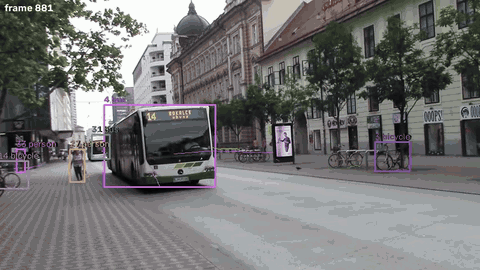

# yolo-kalman — native YOLO + GPU Kalman multi-object tracker with occlusion-robust ids



*Tracker output, frames 77–181 of "Inbound B Branch train, March 2021" by Flickr user 132192938@N04
([CC BY 2.0](https://creativecommons.org/licenses/by/2.0/), via
[Wikimedia Commons](https://commons.wikimedia.org/wiki/File:Inbound_B_Branch_train,_March_2021.webm)).
A white van (id 21) crosses the foreground and fully hides the parked cars for about 1 second.
Cars 5, 9 and 12 have the same ids when the van has gone.
Changes: tracking boxes, ids and trails added; scaled to 640 px; 12 fps.*

Full manual (diagrams, procedures, configuration, results): [`docs/index.html`](docs/index.html).
Rebuild it with `python3 docs/build_docs.py` after editing `docs/index.src.html`.

YOLO (Ultralytics YOLO26m) is used **only as the detector**. The tracker is my own code
(no `model.track()`, no boxmot). It runs in PyTorch on the GPU, batched over tracks and over
streams:

* **Kalman filter**: constant velocity on (cx, cy, w, h). BoT-SORT-style noise, NSA measurement noise
  `R·(1−conf)`, exact multi-step prediction (`kalman.py`). Tested against a NumPy reference.
* **Association cascade**: BYTE two-stage (high, then low score) with IoU + Mahalanobis (χ² 0.99) gating.
  OC-SORT **OCM** (direction-consistency term), **OCR** (last-observation IoU) and **ORU**
  (re-update along a virtual linear trajectory over the gap when a lost track is matched again).
  Appearance stage (S4) for long occlusions, and *young-track id recovery*: a freshly born track
  whose embedding matches a track that was already lost inherits the old id.
* **Lost-track buffer**: tracks coast on the KF prediction for `lost_buffer_s` (default 8 s), with size
  velocity frozen while lost.
* **Partial-occlusion handling** (needed to make the full-occlusion cases work with a real detector):
  a box much smaller than the track's slow-EMA reference size is a *low-quality* observation. The
  track coasts through it (R×1e4, no size velocity), and it is not used as an OC-SORT observation.
* **Appearance re-ID**: torchvision ResNet-18 (ImageNet) on RoI-aligned 128×64 crops taken straight from
  the decoded CUDA frames, giving 512-d features with a dynamic EMA per track. **Choice:** OSNet/torchreid
  weights are person-only (we also track vehicles/animals), distributed via Google Drive, and torchreid
  is unmaintained on PyPI. A generic class-agnostic descriptor installs from the PyTorch index. It sits
  behind a one-method interface (`reid.AppearanceEncoder`), so a proper re-ID net can replace it.
* **Duplicate detections**: the detector sometimes gives one object two times (a second box, or a
  second class label such as car + truck): 2,794 pairs of boxes with IoU > 0.8 in 10,560 frames of the
  12 real clips (`scratch/dup_probe.py`). Each copy started its own track, so one object had two ids for
  some frames. `detector.duplicate_of_better` now drops the lower-score box of such a pair (any class).
  Frames where two tracks overlap with IoU > 0.8: 244 before, 25 after (`results/real_dedup`); the
  synthetic occlusion table is unchanged for the full tracker. The real-clip and throughput tables below
  are from runs before this change; a re-run at 16 streams gives 5,275 fps (before: 5,272,
  `results/bench/bench_dedup.json`).
* **Assignment**: all cost matrices are computed on the GPU, and by default the whole matching cascade
  runs there too, using a **batched exact GPU Hungarian solver** (see next section). The previous CPU
  cascade with `lap.lapjv` is kept as the reference (`TrackerConfig(assign="lapjv")`, `--assign lapjv`).

## Assignment: batched GPU Hungarian (`assign.py`)
**Method.** Exact Hungarian / Kuhn–Munkres in its *shortest augmenting path* form with row/column dual
potentials (the Jonker–Volgenant family; the classical O(n²·m) "insert one row, Dijkstra on reduced
costs, update duals, flip the path" formulation). It is not an auction or epsilon method, has no
iteration cap, and keeps complementary slackness after every augmentation, so the result is an optimal
assignment. Duals are float64; costs are the same float32 values the lapjv path sees.

**cost_limit semantics.** `lap.lapjv(c, extend_cost=True, cost_limit=L)` solves an (R+C)×(R+C)
extended problem where every row or column may stay unmatched at cost L/2. Its optimum equals
`min Σ_matched (c_ij − L) + L(R+C)/2`. So pairs with `c > L` are never matched (forbidden here), and
pairs with `c == L` tie with "unmatched" (here they are matched). The kernel solves the equivalent
n×(m+n) problem: compacted rows × (real columns with cost c−L, then n zero-cost dummy columns =
"row unmatched"). Rows and columns without any allowed pair are dropped first. Padding is handled with
masks: each stream's live tracks and still-free detections are `row_mask [S,M]` / `col_mask [S,N]`
over the fixed padded `[S,M,N]` cost tensor.

**Kernel.** One thread block per stream, so all streams are solved in one launch. 256 threads find
the allowed rows/columns (one coalesced pass) and stage the compacted sub-matrix in shared memory
when it fits the device's per-block limit (99 KB on the RTX PRO 6000: up to ~22.6k cells, 150×150).
Bigger problems (up to the 160×160 slot/detection limit) read the padded matrix in global memory
through the column index; `tests/test_assign.py::test_crowd_size_dense` covers both paths.
Then one warp runs the search: columns are strided over the lanes, and the Dijkstra arg-min is a
warp-shuffle reduction where ties go to the lowest column index (deterministic). All data-dependent
loops live inside the kernel, so a solve is one fixed launch: it can be captured in a CUDA graph and
needs no host sync. It is registered as the torch custom op `yolo_kalman::lap_batch`, so
`torch.compile` traces the cascade around it. The kernel is JIT-built with `torch.utils.cpp_extension`
(nvcc, cached in `~/.cache/torch_extensions`).

**Using the solver.** `lap_batch(cost, row_mask, col_mask, limit)` takes CUDA tensors only:
`cost [S,R,C]` float32 (low = good), `row_mask [S,R]` and `col_mask [S,C]` bool (which rows and
columns take part), and one `limit` for all streams. It returns `[S,R]` int64: the matched column of
each row, or `-1` (unmatched, masked, or every allowed pair above `limit`). It is the same optimum as
calling `lap.lapjv(cost[s][rows][:, cols], extend_cost=True, cost_limit=limit)` per stream.
```python
import torch
from yolo_kalman.assign import lap_batch

# 2 streams, 3 tracks (rows) x 4 detections (columns); cost = 1 - IoU
cost = torch.tensor([[[0.10, 0.90, 0.95, 0.70],
                      [0.85, 0.20, 0.90, 0.95],
                      [0.90, 0.90, 0.90, 0.90]],
                     [[0.30, 0.25, 9e4, 9e4],
                      [0.20, 0.40, 9e4, 9e4],
                      [9e4, 9e4, 9e4, 9e4]]], device="cuda")
rows = torch.tensor([[True, True, True], [True, True, False]], device="cuda")  # tracks in this stage
cols = torch.ones(2, 4, dtype=torch.bool, device="cuda")                      # free detections
print(lap_batch(cost, rows, cols, 0.8).tolist())   # [[0, 1, -1], [1, 0, -1]]
```
Stream 0, row 2 stays unmatched because all its costs are above 0.8. Stream 1 picks row 0 → column 1
and row 1 → column 0 (0.25 + 0.20 = 0.45), not the diagonal (0.30 + 0.40 = 0.70); row 2 is masked out.

How the tracker uses it (`MultiStreamTracker._gmatch_core`): each cascade stage builds its cost plane
for all streams, sets gated pairs (Mahalanobis gate, other class group, no embedding) to `BIG = 6e4`
(above any limit, so they are forbidden), and calls `lap_batch` with `row_mask = stage tracks & not
yet matched` and `col_mask = stage detections & not yet used`, and the stage limit (S1 0.8, S2 0.5,
S3 0.7, S4 0.25, S5 0.7). The result marks rows matched and columns used for the next stage. Id
recovery is a sixth call: rows = LOST tracks, columns = young TRACKED tracks, cost = embedding
distance, limit 0.25. Inside the tracker the six calls are recorded in the *match* CUDA graph.
Select the CPU reference instead with `TrackerConfig(assign="lapjv")` or `--assign lapjv` on
`scripts/track.py`, `scripts/bench.py` and `scripts/eval_synth.py`.

**Why a CUDA kernel (measured).** A pure-PyTorch version of the same algorithm, vectorised over
streams, was measured and then removed (it had no caller outside the tests). Its loop length depends
on the data, so it needs a host sync per Dijkstra step: 49 ms for 8×(20×20) and 171 ms for
16×(40×40) dense random problems, against 0.15 / 0.57 ms for the CUDA kernel and 0.14 / 0.54 ms for
lapjv. `lap_batch` now raises on CPU tensors. I did not try Triton: the search is scalar
pointer-chasing (path back-tracking, a single "current row"), which fits a warp-synchronous CUDA loop
better than Triton's block programming model. On
tracking-like sparse costs (true pair cheap, three plausible distractors per row, the rest gated), one
launch for all streams against lapjv called per stream in a Python loop:

| streams × rows × cols | GPU Hungarian (one launch) | lapjv (per stream, CPU) |
|---|---|---|
| 8 × 20 × 20 | 0.038 ms | 0.148 ms |
| 16 × 30 × 30 | 0.054 ms | 0.381 ms |
| 16 × 60 × 60 | 0.155 ms | 0.918 ms |
| 32 × 40 × 40 | 0.084 ms | 1.048 ms |
| 32 × 150 × 150 | 0.879 ms | 9.780 ms |

(`scratch/try_lap2.py`, including launch overhead, outside CUDA graphs. Inside the tracker graph a
solve costs about 7.5 µs.)

**Exactness evidence.** (1) The algorithm is exact: no epsilon, no iteration cap, float64 duals.
(2) `tests/test_assign.py`: total cost equals scipy `linear_sum_assignment` on the explicit extended
matrix *and* lapjv for random rectangular problems (1–47 rows/cols, 0/50/90% gated, ties, limits
0.25–1.5), for 1×N, N×1, empty, all-gated, values at the limit, 3e38 / 6.55e4 entries, NaN/inf (never
matched) and integer costs with many ties. Also: 32 mixed-size streams in one padded [32,160,160]
batch, identical answers on repeated calls (deterministic ties), CUDA-graph replay and torch.compile.
(3) Tracker: frame-identical output to the lapjv cascade on the synthetic scenes; on real-clip
replays, equal total cost in 8,536/8,536 problems (below).

**Cascade on the GPU.** With `assign="gpu_hungarian"` the five stages S1–S5, track birth (the k-th
leftover detection goes to the k-th free slot, via cumsum ranks), id recovery and all per-track
bookkeeping (state, ids, ages, hits, size reference, embedding EMA weights) are GPU tensors. One
tracker step is 3 CUDA graphs: *pre* (predict + cost terms), *match* (cascade: 6 solver launches plus
fused element-wise code), and *post* (KF update / ORU / init / EMA + output packing). There are no host
syncs inside a step. `submit()` enqueues a step and `collect()` syncs once for all pending steps, so the
pipeline syncs once per chunk of 8 frames instead of twice per frame. The cost terms go through the
same fp16 rounding as the lapjv path. As a result the GPU cascade reproduces the lapjv cascade frame
for frame on the synthetic test scenes (identical ids, boxes and counters: `test_gpu_hungarian_cascade_matches_lapjv`).

## GPU pipeline (`pipeline.py`)
```
NVDEC (PyNvVideoCodec ThreadedDecoder, frames stay in device memory, DLPack -> torch)
 -> GPU letterbox + normalise into one [S*T,3,384,640] fp16 batch          (S streams x T=8 frames)
 -> TensorRT FP16 YOLO26m, NMS-free end2end head [B,150,6] (no host sync)  (one batched call)
 -> un-letterbox, RoI-align crops -> ResNet-18 fp16 embeddings (one call for all streams)
 -> tracker step per frame for all S streams at once:
      CUDA graph pre (predict + all cost terms) -> graph match (cascade, batched GPU Hungarian) ->
      graph post (masked KF update / ORU / init / EMA) -> pinned ring; one host sync per chunk
      (--assign lapjv: graph A -> pinned host -> CPU cascade with lapjv -> graph B, 2 syncs/frame)
```
A reader thread (decode + letterbox, double-buffered) and a detector thread (TRT + embed) run on
low-priority CUDA streams. The tracker runs on a high-priority stream. The tracker's dense GPU code is `torch.compile`d (inductor) and then
captured in CUDA graphs, with an element-wise 4×4 Cholesky so inductor can fuse it. On 16 streams this
cut tracker GPU time per step from 1.65 ms to 0.5 ms. Images never leave the GPU (only the optional
overlay writer downloads frames).

**What works for decode:** PyNvVideoCodec 2.2.4 NVDEC decodes the VP9 WebM clips and the MPEG-4
synthetic clips: about 5,000 fps for one 480p stream and about 20,000 fps aggregate for 16 decoders.
torchcodec was not needed (it also needs system FFmpeg libs, which are not installed). OpenCV CPU decode
is the fallback.

**Detector:** `scripts/export_trt.py` exports to TensorRT FP16 with a dynamic batch of up to 64 at
384×640. Both the NMS-free end2end head (default) and the raw one-to-many head (with our own one-call
GPU `batched_nms`) work, and outputs match Ultralytics `predict`. The TensorRT export **worked**; the
torch FP16 fallback (`TorchYolo`) exists but was not needed. The engine alone does about 3,300 img/s
per GPU (batch 32–64). The detector sits behind the small `Detector` protocol (`detector.py`):
letterboxed fp16 batch in, padded GPU tensors out. A permissive detector (YOLOX, RT-DETR/D-FINE) can be
dropped in. I did not build one; see "not done".

## Commands
```bash
~/.local/bin/uv sync                                   # env (torch 2.14+cu130, TensorRT 11.5, PyNvVideoCodec); dev group: pytest
./run.sh scripts/download_clips.py                     # Wikimedia 480p VP9 transcodes -> clips/ (untrusted data)
./run.sh scripts/export_trt.py yolo26m.pt --nms-free   # TRT FP16 engine -> models/ (downloads yolo26m.pt)
./run.sh scripts/make_synthetic.py                     # synthetic occlusion clips + GT -> data/synth
REQUIRE_E2E=1 ./run.sh -m pytest -rs -q               # 25 tests (KF, solver vs scipy/lapjv, detector, synthetic, e2e)
./run.sh scripts/eval_synth.py --overlay               # HOTA/IDF1/IDSW + ablations -> results/synth (--assign lapjv)
./run.sh scripts/track.py clips/*.webm --out results/real --overlay   # all clips as parallel streams
./run.sh scripts/bench.py --streams 1 4 8 16 32 --gpus 0 1 --frames 1200 --repeats 3 --assign gpu_hungarian  # or --assign lapjv
./run.sh scripts/bench_table.py "audit_gpu_hungarian"      # markdown table from results/bench/bench_<tag>*.json
```
`run.sh` = `.venv/bin/python -I` with `LD_LIBRARY_PATH` unset. The host path puts cuDNN 9.20 ahead of
the venv's 9.24, which breaks every conv.

The two e2e tests need gitignored files (`models/*.engine`, `clips/`, `data/synth/*.mp4`). Without them
they skip, and a plain `pytest` still looks green. `REQUIRE_E2E=1` turns a missing file into a failure;
`-rs` lists any skip. Treat a skip as "occlusion claim not verified".

## Results

### Synthetic clips with ground truth (real detector, full pipeline)
People walk behind a grey bar that hides them completely for a known number of frames (bar widths
set for 10/30/60/120-frame gaps; a third person walks the other way and is hidden longer). A separate
clip has a head-on crossing plus an X crossing. Ground truth = objects with visibility ≥ 0.3. HOTA is
my re-implementation of the TrackEval algorithm (sanity-checked on toy cases); IDF1/MOTA/IDSW come from
motmetrics. The last column is my direct check: is the id 1 s after reappearing equal to the id before
the full occlusion?

| variant | clip | HOTA | AssA | DetA | IDF1 | MOTA | IDSW | frag | GT ids | pred ids | same id after full occlusion (1 s later / immediately) |
|---|---|---|---|---|---|---|---|---|---|---|---|
| full (BYTE+OC-SORT+re-ID) | synth_gap010 | 0.873 | 0.879 | 0.868 | 0.949 | 0.900 | 0 | 5 | 3 | 3 | 3/3 / 3/3 |
| full (BYTE+OC-SORT+re-ID) | synth_gap030 | 0.863 | 0.869 | 0.857 | 0.944 | 0.889 | 0 | 5 | 3 | 3 | 3/3 / 3/3 |
| full (BYTE+OC-SORT+re-ID) | synth_gap060 | 0.854 | 0.860 | 0.849 | 0.944 | 0.891 | 0 | 6 | 3 | 3 | 3/3 / 3/3 |
| full (BYTE+OC-SORT+re-ID) | synth_gap120 | 0.875 | 0.876 | 0.875 | 0.965 | 0.931 | 0 | 4 | 3 | 3 | 3/3 / 3/3 |
| full (BYTE+OC-SORT+re-ID) | synth_crossing | 0.883 | 0.900 | 0.866 | 0.946 | 0.896 | 0 | 3 | 4 | 4 | 1/1 / 1/1 |
| no re-ID | synth_gap010 | 0.873 | 0.879 | 0.868 | 0.949 | 0.900 | 0 | 5 | 3 | 3 | 3/3 / 3/3 |
| no re-ID | synth_gap030 | 0.799 | 0.745 | 0.857 | 0.845 | 0.885 | 1 | 5 | 3 | 4 | 2/3 / 2/3 |
| no re-ID | synth_gap060 | 0.655 | 0.485 | 0.884 | 0.618 | 0.931 | 5 | 4 | 3 | 6 | 0/3 / 0/3 |
| no re-ID | synth_gap120 | 0.637 | 0.462 | 0.878 | 0.568 | 0.928 | 3 | 4 | 3 | 6 | 0/3 / 0/3 |
| no re-ID | synth_crossing | 0.864 | 0.849 | 0.879 | 0.880 | 0.902 | 1 | 3 | 4 | 5 | 1/1 / 1/1 |
| no ORU/OCM/OCR | synth_gap010 | 0.839 | 0.775 | 0.908 | 0.829 | 0.949 | 1 | 6 | 3 | 4 | 3/3 / 3/3 |
| no ORU/OCM/OCR | synth_gap030 | 0.832 | 0.770 | 0.900 | 0.830 | 0.943 | 1 | 7 | 3 | 4 | 3/3 / 3/3 |
| no ORU/OCM/OCR | synth_gap060 | 0.840 | 0.848 | 0.833 | 0.938 | 0.879 | 0 | 6 | 3 | 3 | 3/3 / 3/3 |
| no ORU/OCM/OCR | synth_gap120 | 0.876 | 0.876 | 0.875 | 0.965 | 0.931 | 0 | 4 | 3 | 3 | 3/3 / 3/3 |
| no ORU/OCM/OCR | synth_crossing | 0.919 | 0.923 | 0.916 | 0.970 | 0.944 | 2 | 2 | 4 | 5 | 1/1 / 1/1 |
| ByteTrack-like (1 s buffer, no OC-SORT, no re-ID) | synth_gap010 | 0.831 | 0.761 | 0.906 | 0.860 | 0.942 | 3 | 6 | 3 | 5 | 2/3 / 2/3 |
| ByteTrack-like (1 s buffer, no OC-SORT, no re-ID) | synth_gap030 | 0.679 | 0.512 | 0.899 | 0.653 | 0.936 | 5 | 6 | 3 | 7 | 0/3 / 0/3 |
| ByteTrack-like (1 s buffer, no OC-SORT, no re-ID) | synth_gap060 | 0.653 | 0.483 | 0.884 | 0.618 | 0.927 | 5 | 6 | 3 | 7 | 0/3 / 0/3 |
| ByteTrack-like (1 s buffer, no OC-SORT, no re-ID) | synth_gap120 | 0.637 | 0.462 | 0.878 | 0.568 | 0.928 | 3 | 4 | 3 | 6 | 0/3 / 0/3 |
| ByteTrack-like (1 s buffer, no OC-SORT, no re-ID) | synth_crossing | 0.925 | 0.926 | 0.923 | 0.968 | 0.943 | 4 | 2 | 4 | 5 | 1/1 / 1/1 |

The full tracker kept **13/13 full occlusions with the same id (gaps up to 157 frames), with 0 ID
switches on every clip**. Without re-ID, motion alone carries the id through about 10–30 frames of
full occlusion. Gaps of 60 frames or more fail, because people do not reappear exactly where a
constant-velocity model puts them when their box was partially eroded before vanishing. The
ByteTrack-like baseline fails from 30 frames on.

Re-run after the GPU Hungarian change (`results/synth/metrics.md` = `--assign gpu_hungarian`,
`metrics_lapjv.md` = `--assign lapjv`): both tables are identical to each other and to the table above,
for every variant and clip.

Unit tests with simulated detections (`tests/test_synthetic.py`) cover gaps of 10/30/60/120 frames
(4 scenes as 4 batched streams, with and without re-ID), a speed change behind the occluder (needs
re-ID), crossings with no swap, clutter (HOTA > 0.7, IDF1 > 0.85, IDSW = 0), and CUDA-graph/compiled
output identical to eager.

### Real clips (no ground truth)
12 open-licence Wikimedia Commons clips (480p VP9 transcodes), tracked as 12 parallel streams on one
GPU, with classes person, bicycle, car, motorcycle, bus, truck, bird, cat and dog. *Fragmentations* =
number of times a track id disappears and later reappears. With re-ID many more objects are *re-acquired
under their old id*, so fragmentations go **up** while the number of ids goes **down**. Without ground
truth I cannot rule out that some of the extra re-acquisitions are wrong merges; that is unverified.
Overlays with ids and trails: `results/real/*_tracks.mp4` and `results/demo/` (not in git).

| clip | licence | frames | ids (full) | ids (no re-ID) | ids ≥1 s (full / no re-ID) | fragmentations (full / no re-ID) | re-appear after ≥1 s gap (full / no re-ID) | max gap bridged (frames) |
|---|---|---|---|---|---|---|---|---|
| Calle_preciados.webm | CC BY-SA 3.0 | 456 | 37 | 39 | 20 / 36 | 145 / 69 | 24 / 22 | 138 |
| Inbound_B_Branch_train__March_2021.webm | CC BY 2.0 | 2100 | 107 | 139 | 50 / 66 | 441 / 251 | 81 / 49 | 215 |
| Lisboa_Carris__40267618395.webm | CC BY 2.0 | 225 | 19 | 20 | 11 / 12 | 35 / 22 | 2 / 2 | 104 |
| London_United_LTZ1130_passing_House_of_Commons_i | CC BY 3.0 | 116 | 23 | 30 | 6 / 5 | 37 / 8 | 5 / 1 | 87 |
| MD_355_and_MD_124_Gaithersburg_MD_2022_07_30_11_ | CC BY 4.0 | 1974 | 85 | 126 | 42 / 103 | 734 / 363 | 137 / 58 | 238 |
| Roncesvalles_Ave_crossing_at_Galley_Ave__PXO_Typ | CC BY-SA 4.0 | 390 | 13 | 14 | 11 / 12 | 18 / 17 | 2 / 2 | 61 |
| Soundscapes_of_Norrk_ping__1____Skvallertorget.w | CC BY 3.0 | 1702 | 84 | 107 | 43 / 55 | 338 / 170 | 53 / 18 | 237 |
| Soundscapes_of_Norrk_ping__4____Train_station.we | CC BY 3.0 | 1994 | 59 | 87 | 32 / 50 | 291 / 145 | 47 / 18 | 235 |
| Starling_bathing_one_sparrow_eating_two_doves_wa | CC BY 3.0 | 10540 | 27 | 39 | 14 / 18 | 224 / 148 | 43 / 22 | 434 |
| Strassenbahn_Gmunden_in_der_Alois_Kaltenbruner_S | CC BY 3.0 | 3521 | 53 | 84 | 18 / 21 | 257 / 166 | 28 / 11 | 214 |
| Traffic_on_Slovenska_street.webm | CC BY 3.0 | 1353 | 74 | 116 | 43 / 75 | 335 / 117 | 76 / 23 | 194 |
| Traffic_on_Slovenska_street_2.webm | CC BY 3.0 | 466 | 22 | 32 | 15 / 17 | 79 / 55 | 12 / 11 | 77 |
| **total** | | 24837 | **603** | 833 | | | 510 / 237 | |

**GPU Hungarian vs lapjv on real data.** I recorded the tracker inputs of 300 frames × 12 clips once and
replayed the identical inputs through both trackers (`scratch/real_replay.py`,
`scratch/real_solver_check.py`). Every one of the 8,536 non-empty assignment problems the GPU cascade
solved was re-solved with lapjv: **total cost equal in 8,536/8,536 (max difference 0.0)**. In 222
(2.6%) the two solvers return different optimal assignments (ties: fp16-quantised costs make equal
totals common). Track outcomes over the replay: 227 unique ids for both, ids differ in 1 of ~3,450
stream-frames, and one extra S4 re-ID match (176 vs 175). A "strict" variant that leaves pairs with
`c == cost_limit` unmatched is much further from lapjv (154 stream-frames with different ids), so
lapjv evidently matches at equality, as the kernel does. Full runs (`scripts/track.py`, all frames,
new code): lapjv 619 / 601 ids in two runs (509 / 504 re-acquisitions ≥1 s), gpu_hungarian 591 / 595
ids (520 / 508). The spread between runs of the *same* solver is as large as the difference between
solvers.

Tracker counters for the full run: 3,291 ORU re-updates, 1,217 appearance re-IDs (S4), 729 OCR
matches, 175 young-track id recoveries, 0 dropped detections, 0 slot overflows.

### Throughput (end-to-end: NVDEC → TRT → re-ID → tracker, no overlay)
`scripts/bench.py`: the 5 longest clips repeated round-robin, 1,200 frames per stream, one worker
process per GPU (streams split across GPU 0/1). NVML is sampled every 100 ms during the run. Stage
columns are per-worker sums of wall time. Reader (decode/letterbox), detector (TRT/embed) and tracker
threads overlap, so the columns add up to more than the wall time. Same code for both rows, only
`--assign` differs. Each setting ran 3 times; the table shows the median-FPS run (all three in
`fps_runs` of `bench_audit_*.json`; run-to-run spread ≤ 6%).

**Tracker split.** For `gpu_hungarian` the three numbers are **GPU time** between CUDA events around the
three graphs (pre / match / post). They include time the tiny tracker kernels spend waiting for SMs
occupied by TensorRT. Alone, one step for 8 streams takes 0.07 / 0.11 / 0.12 ms. For `lapjv` they are
host wall time (graph A + sync / CPU cascade / graph B + sync).

**Default, `--assign gpu_hungarian`:**

| solver | streams | GPUs | frames | wall s | FPS total | FPS/stream | GPU util % (mean per GPU) | NVDEC % | decode s | letterbox s | detect s | embed s | track s | tracker pre / match / post s |
|---|---|---|---|---|---|---|---|---|---|---|---|---|---|---|
| gpu_hungarian | 1 | 1 | 1200 | 1.0 | 1236 | 1236 | 53 | 5 | 0.07 | 0.03 | 0.36 | 0.58 | 0.61 | 0.09 / 0.19 / 0.20 |
| gpu_hungarian | 4 | 2 | 4800 | 1.3 | 3687 | 922 | 71 / 62 | 9 / 9 | 0.12 | 0.06 | 0.54 | 0.73 | 0.97 | 0.19 / 0.28 / 0.29 |
| gpu_hungarian | 8 | 2 | 9600 | 2.1 | 4582 | 573 | 75 / 76 | 12 / 12 | 0.32 | 0.20 | 1.08 | 0.99 | 1.79 | 0.47 / 0.47 / 0.46 |
| gpu_hungarian | 16 | 2 | 19200 | 3.6 | 5272 | 329 | 85 / 82 | 14 / 14 | 0.99 | 0.47 | 2.30 | 1.31 | 3.43 | 0.63 / 1.11 / 1.16 |
| gpu_hungarian | 32 | 2 | 38400 | 6.8 | 5664 | 177 | 91 / 89 | 15 / 15 | 1.66 | 0.39 | 4.39 | 2.21 | 5.66 | 1.37 / 1.64 / 1.92 |

**Reference, `--assign lapjv`** (same pipeline, CPU cascade):

| solver | streams | GPUs | frames | wall s | FPS total | FPS/stream | GPU util % (mean per GPU) | NVDEC % | decode s | letterbox s | detect s | embed s | track s | tracker pre / match / post s |
|---|---|---|---|---|---|---|---|---|---|---|---|---|---|---|
| lapjv | 1 | 1 | 1200 | 1.4 | 868 | 868 | 40 | 4 | 0.09 | 0.05 | 0.32 | 0.86 | 1.28 | 0.35 / 0.68 / 0.16 |
| lapjv | 4 | 2 | 4800 | 2.0 | 2437 | 609 | 47 / 47 | 5 / 7 | 0.12 | 0.07 | 0.46 | 1.07 | 1.70 | 0.44 / 0.92 / 0.22 |
| lapjv | 8 | 2 | 9600 | 3.4 | 2837 | 355 | 51 / 50 | 7 / 7 | 0.22 | 0.13 | 0.35 | 1.91 | 3.09 | 0.69 / 1.84 / 0.45 |
| lapjv | 16 | 2 | 19200 | 6.0 | 3200 | 200 | 57 / 55 | 8 / 8 | 0.45 | 0.27 | 0.40 | 3.39 | 5.72 | 1.15 / 3.56 / 0.89 |
| lapjv | 32 | 2 | 38400 | 10.1 | 3798 | 119 | 66 / 66 | 9 / 9 | 1.10 | 0.49 | 0.77 | 5.98 | 9.65 | 1.43 / 6.73 / 1.36 |

| streams | 1 | 4 | 8 | 16 | 32 |
|---|---|---|---|---|---|
| FPS gpu_hungarian | 1,236 | 3,687 | 4,582 | 5,272 | 5,664 |
| FPS lapjv | 868 | 2,437 | 2,837 | 3,200 | 3,798 |
| speed-up | 1.42× | 1.51× | 1.62× | 1.65× | 1.49× |
| previous README (lapjv, single producer thread) | 845 | 2,268 | 2,669 | 3,015 | 3,519 |

The tracker alone (`scratch/prof_trk.py`, 8 streams, synthetic detections with clutter, compiled + CUDA
graphs) takes **0.40 ms per step with the GPU cascade vs 2.09 ms with lapjv**. GPU split: 0.07 ms pre,
0.11 ms match (6 Hungarian launches ≈ 45 µs), 0.12 ms post.

Earlier two-workers-per-GPU runs (`--wpg 2`, lapjv, before this change): 3,378 fps (16) / 3,432 (32).

**Bottleneck analysis (iterations, in order):**
1. Eager tracker with per-track ORU loop: 158 fps for 1 stream, 533 fps for 8 streams on 1 GPU. GPU was
   20–32% busy. Bottleneck: Python kernel launches (≈1,000 tiny kernels per step).
2. Dense fixed-shape slot tensors + 2 CUDA graphs per step: 686 fps for 1 stream, 1,313 fps for 16
   streams on 1 GPU.
3. Batched embeddings across streams (embed time 3.2 s → 0.4 s) and NMS-free YOLO26 head (no host
   sync): 1,554 fps for 16 streams on 1 GPU.
4. `torch.compile` + unrolled 4×4 Cholesky inside the graphs, and a high-priority tracker stream:
   1,943 fps for 16 streams on 1 GPU; 3,015 fps (16 streams) / 3,519 fps (32 streams) on 2 GPUs.
   Then `track ≈ wall`: the consumer was the limiter, mostly the CPU lapjv cascade (~0.2 ms per stream
   per frame) plus two blocking graph syncs per frame. NVML util 55–61%.
5. **GPU Hungarian + GPU cascade** (this change): matching never leaves the GPU, there are 3 graphs per
   step, and one host sync per chunk of 8 frames (`submit`/`collect`). First version: 4,655 fps at 16
   streams. Profiling the tracker alone showed 218 kernels per step, with ~35 batched 8×8 matmuls (KF
   predict/update/ORU) and 6 solver launches at ~20 µs each.
6. KF predict/update rewritten block-wise / element-wise, so inductor fuses them (178 kernels per step).
   The embedding-distance matmul is fp16 on tensor cores. The solver kernel now compacts with all 256
   threads and stages the sub-matrix in shared memory (20 → 7.5 µs per launch). Tracker step:
   0.66 → 0.40 ms. End to end: 4,751 fps (16) / 5,245 fps (32). Now `track < wall` at 32 streams, and
   the single producer thread (decode → letterbox → TRT → embed, serial) was the limiter.
7. Producer split into a reader thread (NVDEC + letterbox into one of two input buffers) and a detector
   thread (TRT + embed). The per-chunk un-letterbox constants are built once (each pageable
   `torch.tensor(..., device=cuda)` blocked until TRT finished). Result: **5,270 fps (16) / 5,702 fps
   (32), NVML util 84–92%**. This exposed a latent race: the NVDEC copy-out is async and the decoder
   recycles its surfaces, which the old per-chunk syncs had hidden. Fixed by a sync after copy-out in
   the reader thread.
8. **Where it stands now.** At 16 streams `track` (3.44 s) ≈ wall (3.6 s) again, but the tracker
   segments are GPU time inflated by contention: the same step takes 0.4 ms alone and ~2.4 ms while
   TensorRT saturates the SMs. NVML util is 84–92%. TRT alone runs at ~3,300 img/s per GPU (6,600 fps
   on 2 GPUs). We reach 80% (16 streams) to 86% (32) of that, with re-ID and tracking sharing the same
   GPU. Remaining headroom is small and would need fewer, larger tracker kernels (e.g. a fused
   CUDA cascade kernel) or running the tracker on a different GPU/MPS partition than TRT.

**Benchmark hang (fixed).** The intermittent 2-GPU hang blamed on concurrent inductor compiles earlier
was really a lost result message. A worker sometimes exited before its multiprocessing queue feeder
thread flushed the final "done", and the parent waited forever. The worker now flushes the queue
(`q.close(); q.join_thread()`), and the parent fails fast if every worker has exited without a
result. In the grid where this was diagnosed, 3 first attempts hung (stack inspection: workers gone,
parent polling the queue). After the fix, 3 first attempts in the same grid still failed *fast* with
rc=1 and passed on retry. Their logs were overwritten, so the cause is not recorded; it may be the new
"results missing" check firing. All later runs passed on the first try: two complete grids (20 runs)
plus 3 repeated 8-stream runs. So the hang is fixed or at least turned into a fast, retryable failure,
but I have not proven the root cause.

## Licences
* **Ultralytics YOLO26 / `ultralytics` package: AGPL-3.0** (accepted for this project). Anything that
  distributes or serves this tracker with the Ultralytics detector inherits AGPL obligations. The
  detector is isolated behind `detector.Detector` so a permissively licensed one (YOLOX Apache-2.0,
  RT-DETR/D-FINE Apache-2.0 via HF transformers) can replace it. The synthetic clips use person sprites
  cut from Ultralytics' bundled `bus.jpg`/`zidane.jpg` (AGPL-3.0 package assets).
* Own tracker code: [Apache-2.0](LICENSE). Third-party material and its terms: [`NOTICE`](NOTICE).
  torchvision ResNet-18 weights: BSD-3 (torchvision).
* Clips: see `meta/clips_index.tsv` (CC BY 2.0/3.0/4.0, CC BY-SA 3.0/4.0, with Wikimedia Commons
  description pages for attribution). They are not committed. Two listed clips (Hofer Verkehrswendetag
  C0258/C0270) have no Wikimedia transcodes (404 for every variant), and their 4K originals are
  2.6 GB / 2.0 GB, so I skipped them.

## Not done / known limitations
* No permissive replacement detector was built (time went into GPU throughput).
* Real-clip quality is unverified without ground truth (id counts and fragmentations only).
* ResNet-18 ImageNet features are not a trained re-ID model. They work on the synthetic clips and
  noticeably reduce id counts on real clips, but similar-looking objects (same-colour cars) can be
  confused. The S4/recovery stages are gated by Mahalanobis distance and class group to limit this.
* A lost track can match the wrong object for a few frames. Example in the GIF at the top: car 11 sits
  on a window of the van for frames 138–140 while the van hides the car.
* HOTA is a re-implementation, not TrackEval itself.
* Ids are unique per stream, not globally.
* GPU Hungarian: exactness is tested in total cost against scipy and lapjv (random and edge-case
  problems) and by frame-identical tracker output against the lapjv path. Where several optimal
  assignments exist, its tie-breaking (lowest column index, `c == cost_limit` counts as matched) can
  differ from lapjv's; none of the synthetic suites contains such a case that changes ids.
* The GPU cascade always runs the ORU branch of the post graph (masked per slot). The lapjv path only
  runs it on frames that need it.
* The CUDA kernel is JIT-built on first use (≈40 s, needs nvcc from /usr/local/cuda). `lap_batch`
  needs CUDA tensors; a tracker on a CPU device uses the lapjv cascade automatically.
* The end-to-end pipeline is not bit-deterministic run to run (lapjv against itself already diverges
  within 5–170 frames on real clips, even with the sequential pipeline). That is detector/embedding
  numerics, not the solver. Solver comparisons on real data therefore use recorded-input replays (see
  "Real clips" above).
